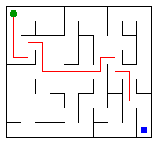

# Assignment 3. Maze Escape

Student ID: 252692
Name:
Group:
Maze size (rows x columns): 9 x 10

This file is the report. Fill it in as you go. How to start: `START_HERE.md`. The task: `docs/Assignment3.pdf`.

## Program output

The 13 lines your program prints on your data (`java -cp out Main`):

    Broken: 89
    Kept: 72
    Last broken wall: 151
    MST cost: 25712
    Heaviest broken wall: 699
    Path length: 21
    DFS visited: 54
    Dead ends: 25
    Zones: 90
    Largest zone: 1
    Is DAG: 1
    Flow stages: 16
    Fastest route cost: 27

My maze:

## Questions

Answer in your own words, two or three sentences each.

Mission 0. What do find and union do, and what makes them fast in your code?

`find(x)` walks up the parent links to the root of x's tree; the root is the name of the group. `union(a, b)` finds both roots and, if they differ, hangs the smaller tree under the larger one and returns true (false if they already share a root). Union by size keeps trees at most O(log n) tall, and path compression makes every node on a searched path point straight to the root, so the amortized cost per operation is O(α(n)), practically constant. My `find` is iterative, so a long chain cannot overflow the stack.

Mission 1. Why is Broken always R*C - 1, and Kept always (R-1)*(C-1)?

We start with R*C separate groups and every broken wall merges exactly two groups, so the count drops by one each time. The grid graph is connected, so in the end one group remains: that takes exactly R*C - 1 breaks (a spanning tree has n - 1 edges). The number of inner walls is R(C-1) + C(R-1) = 2RC - R - C, so Kept = 2RC - R - C - (RC - 1) = RC - R - C + 1 = (R-1)(C-1).

Mission 2. My MST cost from Kruskal and from Prim, and why they are equal:

Kruskal: 25712, Prim: 25712. Both are greedy algorithms that only ever add an edge that is the cheapest across some cut (Kruskal: the cheapest edge joining two different DSU groups; Prim: the cheapest edge leaving the current tree), and by the cut property such an edge belongs to a minimum spanning tree. All costs are different, so the MST is unique and both algorithms build exactly the same tree, therefore the same cost.

Mission 3. Why is there exactly one path between two cells? How did you avoid a stack overflow on a huge maze?

The open doors of Mission 1 form a spanning tree: it is connected (all cells end in one DSU group) and has no cycle (a wall is broken only when its cells were in different groups, so it never closes a loop). In a tree there is a path between any two cells, and if there were two different paths, together they would form a cycle. To avoid a stack overflow, the DFS does not use recursion: it keeps its own array stack of cells plus, for each cell on it, which direction (up, right, down, left) to try next. When the exit is marked, the stack contents are exactly the path from the start.

Mission 4. Why does the second pass of Kosaraju go on the reversed graph? Why do the slides have no cycle exactly when Zones equals the number of cells?

The cell finished last in pass 1 lies in a source zone (no slide enters it from another zone). In the original graph a DFS from it would leak into other zones, but in the reversed graph the slides out of a source zone point inward, so the DFS reaches exactly its own zone. Removing that zone and repeating with the next unfinished cell peels the zones off one by one, in topological order. A zone with two or more cells means cells that reach each other, i.e. a cycle; conversely any cycle puts all its cells in one zone. So no cycle ⇔ every zone has one cell ⇔ Zones = n.

Mission 5. Why is it enough to go through the zones in the order of their numbers? What does this pass cost?

The zone numbers are a topological order: every slide between zones goes from a smaller number to a larger one. So when the pass reaches zone z, every edge that enters z has already been relaxed and the best value of z (cheapest time, longest chain) is final, just like Dijkstra's popped vertex but without a priority queue. Each zone and each slide is looked at once, so the pass costs O(n + m) time and O(n + m) space.

## AI use

The syllabus requires you to say which AI tools you used and for what. Write the tool (ChatGPT, Copilot, other) and what you asked it: explain an idea, find an error, review code. Write "none" if you did not use any. If you took code or text from a book or a website, give the source here.

TODO, write honestly in your own words: which AI tool you used and for what (e.g. explaining Kosaraju, reviewing code, checking README answers).

## Timing (Mission 7)

Milliseconds, 5 runs each, from `java -cp out Bench`.

| maze | Kruskal | Prim |
|---|---|---|
| 100 x 100 | 9 | 10 |
| 300 x 300 | 40 | 109 |
| 1000 x 1000 | 418 | 2372 |

What do the numbers say about how the time grows? Two or three sentences.

Going from 300x300 to 1000x1000 multiplies the number of cells by about 11, and Kruskal's time grows by about 10x, Prim's by about 22x: both grow a bit faster than linearly, which matches O(m log m). Prim is several times slower because its `PriorityQueue<Long>` boxes every entry and pushes up to two entries per wall, while Kruskal sorts a primitive `long[]` and the DSU operations are almost free. The first small runs are noisy because the JVM is still warming up (JIT).

## Complexity

n is the number of cells, m the number of walls (or slides). Fill in every algorithm you wrote.

| algorithm | time | space | assumptions |
|---|---|---|---|
| DSU find and union | O(α(n)) amortized per operation | O(n) | union by size + path compression |
| Kruskal | O(m log m) | O(n + m) | sorting dominates; m ≈ 2n in a grid |
| Prim | O(m log m) | O(n + m) | binary heap (PriorityQueue), lazy deletion |
| DFS | O(n + m) | O(n) | own array stack, no recursion |
| Kosaraju | O(n + m) | O(n + m) | two iterative DFS passes, forward + reversed lists |
| Route in the zone graph | O(n + m) | O(n + m) | zones already in topological order; no priority queue |

## Before you submit

- data/walls.txt, data/slides.txt and output/maze.png are in the repository.
- `java tools/Check.java` shows all examples right.
- This README is filled in, the program output and the section AI use included.
- The work is pushed to main (at least one commit per mission) and the repository is public.
- The link is attached in Moodle.
